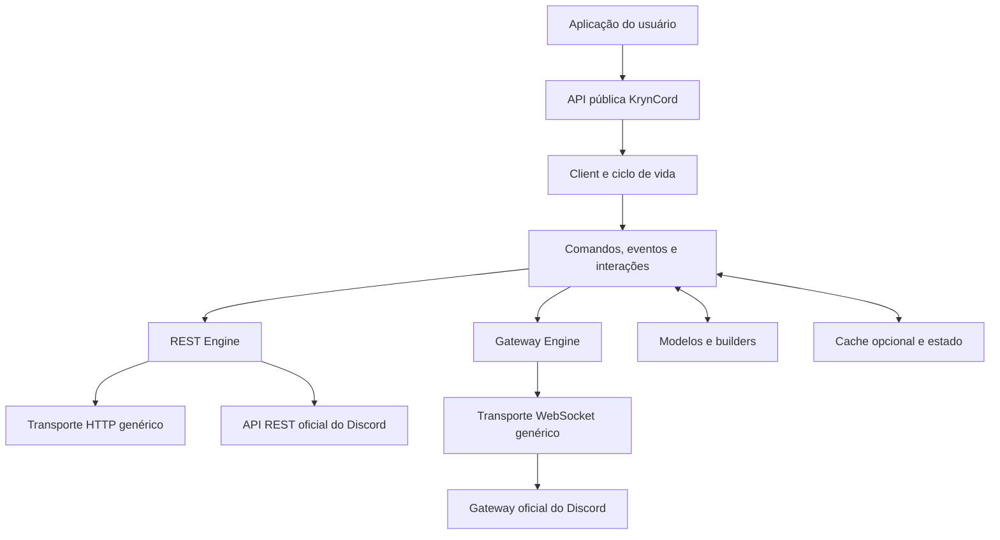

# KrynCord — Arquitetura e estrutura do projeto

> Documento de arquitetura inicial da KrynCord, uma biblioteca Python independente para criar bots Discord.
>
> **Status:** proposta técnica para orientar a implementação. A estrutura abaixo é o destino planejado; nem todos os módulos estarão implementados no primeiro estágio.

## 1. Visão do projeto

A KrynCord será uma biblioteca assíncrona para interagir com a API oficial do Discord. A meta é oferecer uma experiência moderna e tipada, inspirada em boas decisões de design de bibliotecas como discord.js, Hikari e Serenity, sem depender de nenhuma biblioteca que já implemente o protocolo Discord.

A KrynCord poderá usar bibliotecas genéricas para HTTP, WebSocket, testes e validação. Essas dependências não devem ser bibliotecas de bots Discord.

### Objetivos

- Implementar a comunicação REST e Gateway em camadas próprias.
- Ser `async-first`, aproveitando `asyncio`.
- Ter API pública pequena, consistente e bem tipada.
- Suportar comandos de aplicação, eventos e interações.
- Oferecer roteamento declarativo de botões, selects e modais por `custom_id`.
- Permitir configurar ou desativar o cache.
- Tratar rate limits e reconexões de forma segura.
- Manter testes de unidade, integração, contrato e desempenho.
- Documentar decisões de arquitetura e compatibilidade.

### Fora do primeiro MVP

- Voice Gateway e transporte de voz.
- Sharding distribuído entre máquinas.
- Extensões nativas em Rust/C.
- Hot reload de módulos.
- Um sistema obrigatório de plugins.
- Um ORM ou banco de dados embutido.
- Descoberta automática obrigatória de comandos.
- Uma implementação de todos os endpoints do Discord logo no início.

## 2. Decisões técnicas iniciais

| Tema | Decisão inicial | Motivo |
|---|---|---|
| Linguagem | Python | Ecossistema assíncrono, acessibilidade e tipagem |
| Compatibilidade | Python 3.11+ inicialmente | `asyncio` moderno e ampla disponibilidade |
| Versão de desenvolvimento | Python 3.13.x estável disponível no ambiente | Desenvolver com versão moderna; testar compatibilidade separadamente |
| Layout | `src/` | Evita importar acidentalmente o código-fonte errado |
| Estilo | Async-first | REST e Gateway são operações de I/O |
| HTTP | `aiohttp` ou `httpx` assíncrono, decisão após protótipo | Usar transporte genérico maduro |
| WebSocket | Transporte genérico compatível com `asyncio`, escolhido após protótipo | Não depender de uma biblioteca Discord |
| JSON | `json` da biblioteca padrão inicialmente | Simplicidade; otimizar somente após benchmark |
| Testes | `pytest` + `pytest-asyncio` | Testes assíncronos e fixtures |
| Lint/format | Ruff | Ferramenta rápida para lint e formatação |
| Tipagem | `mypy` e `py.typed` | Facilitar uso por projetos tipados |
| Build | `hatchling` | Build de pacote Python com configuração simples |
| Cache | Opcional e com política configurável | Não obrigar uso de memória nem prometer estado completo |
| Persistência | Nenhuma embutida | A aplicação escolhe banco e armazenamento |

**Observação sobre dependências:** não fixar todas as versões para sempre neste documento. Antes de adicionar uma dependência ao `pyproject.toml`, conferir a versão atual, o suporte a Python 3.11+, a licença, o histórico de manutenção e a compatibilidade com Windows/Linux.

## 3. Princípios de arquitetura

1. **Separação de responsabilidades:** REST, Gateway, modelos, comandos, interações e cache não devem ficar em um arquivo gigante.
2. **API pública versus internals:** os usuários importam de `kryncord`; detalhes de transporte permanecem internos.
3. **Protocolo oficial como contrato:** payloads, intents, opcodes, limites e respostas devem seguir a documentação oficial do Discord.
4. **Falhas explícitas:** erros HTTP, rate limits, sessões inválidas e reconexões devem ser representados claramente.
5. **Estado opcional:** objetos parciais e dados não presentes no cache devem ser tratados como situações normais.
6. **Testabilidade:** transportes, relógio, espera e backoff devem poder ser simulados em testes.
7. **Desempenho medido:** evitar otimizações prematuras; benchmarks precisam medir cenários reais.
8. **Segurança por padrão:** nunca registrar tokens, limitar exposição de dados sensíveis e não repetir requisições não idempotentes sem garantia.
9. **Compatibilidade documentada:** mudanças públicas devem ter testes, changelog e política de versionamento.
10. **Sem Cogs obrigatórios:** os módulos Python normais são a unidade de organização; carregamento automático será opcional.

## 4. Arquitetura em camadas



### Responsabilidade das camadas

- **API pública:** classes, decorators e tipos que a aplicação usa.
- **Client/runtime:** configura configuração, inicializa recursos, gerencia tarefas e encerra conexões.
- **Dispatch:** transforma eventos e interações recebidos em chamadas de handlers.
- **REST Engine:** autenticação, serialização, rate limits, respostas e erros HTTP.
- **Gateway Engine:** conexão WebSocket, Identify, heartbeat, ACK, eventos, reconexão e resume.
- **Modelos/builders:** representar dados e montar payloads validados.
- **Cache/estado:** manter somente o estado configurado pelo usuário, sem garantir que tudo esteja disponível.

## 5. Estrutura de diretórios proposta

```text
KrynCord/
├── pyproject.toml
├── README.md
├── LICENSE
├── CHANGELOG.md
├── CONTRIBUTING.md
├── CODE_OF_CONDUCT.md
├── SECURITY.md
├── ARCHITECTURE.md
├── .gitignore
├── .editorconfig
├── .github/
│   └── workflows/
│       ├── tests.yml
│       ├── lint.yml
│       └── publish.yml
├── docs/
│   ├── index.md
│   ├── installation.md
│   ├── quickstart.md
│   ├── concepts/
│   │   ├── client-lifecycle.md
│   │   ├── rest-vs-gateway.md
│   │   ├── intents.md
│   │   ├── cache.md
│   │   └── interactions.md
│   ├── guides/
│   │   ├── commands.md
│   │   ├── events.md
│   │   ├── components.md
│   │   ├── responders.md
│   │   ├── error-handling.md
│   │   └── deployment.md
│   ├── api/
│   │   ├── client.md
│   │   ├── commands.md
│   │   ├── interactions.md
│   │   └── models.md
│   ├── internals/
│   │   ├── gateway.md
│   │   ├── rest.md
│   │   ├── rate-limits.md
│   │   └── testing.md
│   └── decisions/
│       ├── 0001-src-layout.md
│       ├── 0002-no-cogs.md
│       └── 0003-optional-cache.md
├── examples/
│   ├── minimal_bot.py
│   ├── rest_only.py
│   ├── slash_commands/
│   ├── events/
│   └── interactions/
├── benchmarks/
│   ├── README.md
│   ├── dispatch.py
│   ├── custom_id_router.py
│   ├── json_decode.py
│   └── cache_memory.py
├── scripts/
│   ├── check_generated.py
│   └── update_discord_schema.py
├── tests/
│   ├── conftest.py
│   ├── unit/
│   ├── integration/
│   ├── contract/
│   ├── performance/
│   └── fixtures/
└── src/
    └── kryncord/
        ├── __init__.py
        ├── py.typed
        ├── version.py
        ├── client.py
        ├── config.py
        ├── intents.py
        ├── enums.py
        ├── errors.py
        ├── logging.py
        ├── lifecycle.py
        ├── api/
        │   ├── __init__.py
        │   ├── users.py
        │   ├── guilds.py
        │   ├── channels.py
        │   ├── messages.py
        │   ├── members.py
        │   ├── roles.py
        │   ├── webhooks.py
        │   └── applications.py
        ├── gateway/
        │   ├── __init__.py
        │   ├── client.py
        │   ├── connection.py
        │   ├── identify.py
        │   ├── heartbeat.py
        │   ├── session.py
        │   ├── reconnect.py
        │   ├── shard.py
        │   ├── payloads.py
        │   ├── opcodes.py
        │   └── compression.py
        ├── http/
        │   ├── __init__.py
        │   ├── client.py
        │   ├── request.py
        │   ├── response.py
        │   ├── routes.py
        │   ├── authentication.py
        │   ├── rate_limits.py
        │   ├── buckets.py
        │   ├── retries.py
        │   └── multipart.py
        ├── rest/
        │   ├── __init__.py
        │   └── client.py
        ├── interactions/
        │   ├── __init__.py
        │   ├── base.py
        │   ├── application_command.py
        │   ├── autocomplete.py
        │   ├── component.py
        │   ├── button.py
        │   ├── select.py
        │   ├── modal.py
        │   ├── response.py
        │   ├── followup.py
        │   ├── context.py
        │   └── types.py
        ├── responders/
        │   ├── __init__.py
        │   ├── decorators.py
        │   ├── registry.py
        │   ├── router.py
        │   ├── patterns.py
        │   ├── params.py
        │   ├── converters.py
        │   └── dispatch.py
        ├── commands/
        │   ├── __init__.py
        │   ├── decorators.py
        │   ├── definitions.py
        │   ├── registry.py
        │   ├── groups.py
        │   ├── options.py
        │   ├── context.py
        │   ├── checks.py
        │   ├── cooldowns.py
        │   ├── errors.py
        │   ├── autocomplete.py
        │   ├── converters.py
        │   ├── sync.py
        │   └── serialization.py
        ├── components/
        │   ├── __init__.py
        │   ├── builders.py
        │   ├── buttons.py
        │   ├── selects.py
        │   ├── text_inputs.py
        │   ├── containers.py
        │   ├── rows.py
        │   └── validation.py
        ├── events/
        │   ├── __init__.py
        │   ├── emitter.py
        │   ├── dispatcher.py
        │   ├── registry.py
        │   ├── names.py
        │   └── payloads.py
        ├── models/
        │   ├── __init__.py
        │   ├── base.py
        │   ├── user.py
        │   ├── guild.py
        │   ├── channel.py
        │   ├── message.py
        │   ├── member.py
        │   ├── role.py
        │   ├── attachment.py
        │   ├── emoji.py
        │   ├── reaction.py
        │   ├── webhook.py
        │   ├── interaction.py
        │   └── partial.py
        ├── builders/
        │   ├── __init__.py
        │   ├── embeds.py
        │   ├── messages.py
        │   ├── commands.py
        │   └── permissions.py
        ├── cache/
        │   ├── __init__.py
        │   ├── protocol.py
        │   ├── memory.py
        │   ├── policy.py
        │   ├── keys.py
        │   └── stats.py
        ├── state/
        │   ├── __init__.py
        │   ├── connection_state.py
        │   ├── guild_state.py
        │   └── event_updates.py
        ├── discovery/
        │   ├── __init__.py
        │   ├── loader.py
        │   ├── imports.py
        │   └── validation.py
        ├── voice/
        │   └── __init__.py
        └── internal/
            ├── __init__.py
            ├── json.py
            ├── tasks.py
            ├── clocks.py
            ├── validation.py
            ├── typing.py
            └── collections.py
```

## 6. Responsabilidade de cada arquivo e módulo

### Raiz do repositório

| Arquivo | Responsabilidade |
|---|---|
| `pyproject.toml` | Metadados do pacote, versão mínima do Python, dependências, ferramentas e configuração de build/testes. |
| `README.md` | Apresentação, instalação, exemplo curto, estado do projeto e links para documentação. |
| `LICENSE` | Licença de distribuição escolhida pelo mantenedor. |
| `CHANGELOG.md` | Mudanças importantes por versão. |
| `CONTRIBUTING.md` | Como preparar ambiente, executar testes e enviar contribuições. |
| `CODE_OF_CONDUCT.md` | Regras de convivência da comunidade. |
| `SECURITY.md` | Como reportar vulnerabilidades sem expô-las publicamente. |
| `ARCHITECTURE.md` | Decisões e limites arquiteturais da biblioteca. |
| `.gitignore` | Ignora `.venv`, caches, artefatos de build, segredos e arquivos temporários. |
| `.editorconfig` | Padroniza indentação e finais de linha entre editores. |

### Pacote público: `src/kryncord/`

| Arquivo | Responsabilidade |
|---|---|
| `__init__.py` | Expõe somente a API pública estável, como `Client` e tipos principais. |
| `py.typed` | Marca o pacote como compatível com tipagem estática para consumidores. |
| `version.py` | Centraliza a versão exposta pelo pacote. |
| `client.py` | Fachada principal para iniciar o bot, registrar handlers e acessar os clientes REST/Gateway. |
| `config.py` | Opções de timeout, cache, logging, intents, transporte e limites. |
| `intents.py` | Define e valida os intents solicitados ao Gateway. |
| `enums.py` | Enumera valores do protocolo quando enumerações são úteis e seguras. |
| `errors.py` | Exceções públicas e hierarquia de erros. |
| `logging.py` | Logging estruturado e filtragem de dados sensíveis. |
| `lifecycle.py` | Inicialização, encerramento, cancelamento de tarefas e liberação de recursos. |

### `api/`

Camada de operações por recurso Discord. Os módulos organizam chamadas de alto nível e não devem duplicar lógica de transporte.

| Arquivo | Responsabilidade |
|---|---|
| `api/__init__.py` | Exportações internas do módulo de API. |
| `users.py` | Operações REST relacionadas a usuários. |
| `guilds.py` | Operações REST de servidores. |
| `channels.py` | Operações de canais e threads. |
| `messages.py` | Envio, edição, leitura e remoção de mensagens conforme permissões e API oficial. |
| `members.py` | Operações com membros de servidores. |
| `roles.py` | Operações com cargos. |
| `webhooks.py` | Criação e execução de webhooks. |
| `applications.py` | Operações de aplicações e comandos de aplicação. |

### `gateway/`

Gerencia a conexão persistente de eventos em tempo real.

| Arquivo | Responsabilidade |
|---|---|
| `gateway/__init__.py` | Exportações internas do Gateway. |
| `client.py` | Coordena o ciclo de vida do Gateway e a entrega de eventos. |
| `connection.py` | Abre e mantém a conexão WebSocket. |
| `identify.py` | Constrói e envia Identify, respeitando limites de sessão. |
| `heartbeat.py` | Agenda heartbeats e acompanha ACKs para detectar conexão travada. |
| `session.py` | Guarda os dados necessários para retomar sessão quando permitido. |
| `reconnect.py` | Política de reconexão, backoff e classificação de códigos de encerramento. |
| `shard.py` | Representa uma shard; uso avançado pode ficar fora do MVP. |
| `payloads.py` | Tipos e validação dos payloads de entrada e saída. |
| `opcodes.py` | Constantes dos opcodes oficiais. |
| `compression.py` | Negociação e decodificação de compressão suportada, adicionada quando necessária. |

### `http/` e `rest/`

A camada HTTP cuida dos detalhes transversais; `rest/` oferece uma fachada de uso.

| Arquivo | Responsabilidade |
|---|---|
| `http/__init__.py` | Exportações internas HTTP. |
| `http/client.py` | Executa requisições com transporte genérico e gestão do ciclo de vida. |
| `http/request.py` | Modelo interno para método, rota, query, headers e corpo. |
| `http/response.py` | Normaliza status, headers e corpo das respostas. |
| `http/routes.py` | Centraliza caminhos e métodos da API; evita strings espalhadas pelo projeto. |
| `http/authentication.py` | Adiciona autenticação de bot sem registrar o token. |
| `http/rate_limits.py` | Interpreta headers, respostas 429 e `retry_after` conforme o contrato oficial. |
| `http/buckets.py` | Agrupa rotas pelos buckets de rate limit identificados pela API. |
| `http/retries.py` | Define quando repetir requisições; não repete cegamente operações não idempotentes. |
| `http/multipart.py` | Prepara uploads e anexos multipart quando necessários. |
| `rest/__init__.py` | Exportações da camada REST. |
| `rest/client.py` | Fachada pública/interna para as operações REST por recurso. |

### `interactions/`

Representa interações recebidas do Discord e suas respostas.

| Arquivo | Responsabilidade |
|---|---|
| `interactions/__init__.py` | Exportações principais de interações. |
| `base.py` | Campos e comportamentos compartilhados entre tipos de interação. |
| `application_command.py` | Dados de comandos de aplicação, incluindo slash commands. |
| `autocomplete.py` | Contexto e resposta de autocomplete. |
| `component.py` | Base para interações de componentes. |
| `button.py` | Dados específicos de interações de botões. |
| `select.py` | Dados de selects e valores selecionados. |
| `modal.py` | Dados e valores enviados por modais. |
| `response.py` | Resposta inicial, defer, edição da resposta e validações de estado. |
| `followup.py` | Mensagens de follow-up associadas à interação. |
| `context.py` | Contexto amigável para handlers, com dados comuns e helpers. |
| `types.py` | Tipos discriminados de interação e payloads correspondentes. |

### `responders/`

Roteador declarativo para botões, selects e modais, usando padrões de `custom_id`.

| Arquivo | Responsabilidade |
|---|---|
| `responders/__init__.py` | Exporta decorators e tipos públicos do roteador. |
| `decorators.py` | Decorators como `@button(...)`, `@select(...)` e `@modal(...)`. |
| `registry.py` | Registra padrões e handlers, detectando conflitos. |
| `router.py` | Encontra o handler compatível com um `custom_id` recebido. |
| `patterns.py` | Faz parsing e validação de padrões, parâmetros e wildcards. |
| `params.py` | Representa os parâmetros extraídos do `custom_id`. |
| `converters.py` | Converte parâmetros para tipos definidos, retornando erros claros. |
| `dispatch.py` | Executa o handler correto e encaminha exceções para o fluxo de erros. |

Exemplo conceitual da API desejada (não significa que os decorators já estejam implementados):

```python
from kryncord import button


@button("/manage/user/:user_id/:action")
async def manage_user(interaction, params):
    user_id = params["user_id"]
    action = params["action"]

    if action == "kick":
        ...
    elif action == "ban":
        ...
```

O roteador deverá definir regras explícitas para parâmetros ausentes, conversões inválidas, padrões duplicados e handlers assíncronos. IDs e dados vindos de interações nunca devem ser tratados como autorização suficiente: permissões precisam ser verificadas.

### `commands/`

Definição, validação, registro e sincronização de comandos de aplicação.

| Arquivo | Responsabilidade |
|---|---|
| `commands/__init__.py` | Exportações públicas de comandos. |
| `decorators.py` | Decorators para declarar comandos sem exigir classes base ou Cogs. |
| `definitions.py` | Modelo interno da definição de um comando. |
| `registry.py` | Registro central, detecção de nomes duplicados e validação. |
| `groups.py` | Comandos agrupados e subcomandos. |
| `options.py` | Tipos, limites e validação de opções. |
| `context.py` | Contexto de execução de um comando. |
| `checks.py` | Verificações reutilizáveis de permissões e condições. |
| `cooldowns.py` | Limites opcionais de uso definidos pela aplicação. |
| `errors.py` | Erros de definição e execução de comandos. |
| `autocomplete.py` | Registro e despacho de callbacks de autocomplete. |
| `converters.py` | Conversão e validação de argumentos de comando. |
| `sync.py` | Sincronização explícita com os endpoints oficiais. |
| `serialization.py` | Converte definições tipadas para payloads da API. |

### `components/`

Builders e validação de componentes de interface.

| Arquivo | Responsabilidade |
|---|---|
| `components/__init__.py` | Exportações dos builders. |
| `builders.py` | Helpers de composição de componentes. |
| `buttons.py` | Builder e validação de botões. |
| `selects.py` | Builders para selects compatíveis com a API. |
| `text_inputs.py` | Inputs de texto usados em modais. |
| `containers.py` | Estruturas de layout suportadas pela versão da API adotada. |
| `rows.py` | Organização de componentes em linhas, quando aplicável. |
| `validation.py` | Valida limites, combinações e formatos antes de enviar payloads. |

Builders devem acompanhar a versão da API documentada e não permitir combinações inválidas conhecidas. Componentes novos só entram após confirmar o formato oficial suportado.

### `events/`

Entrega eventos do Gateway para o código da aplicação.

| Arquivo | Responsabilidade |
|---|---|
| `events/__init__.py` | Exportações públicas do sistema de eventos. |
| `emitter.py` | API para registrar e emitir eventos internos. |
| `dispatcher.py` | Distribui eventos recebidos aos handlers apropriados. |
| `registry.py` | Armazena handlers registrados. |
| `names.py` | Nomes canônicos dos eventos públicos. |
| `payloads.py` | Tipos e parsers para payloads de eventos. |

O dispatcher deve definir se handlers são executados em sequência ou em tarefas independentes. A política deve ser documentada e testada, inclusive para exceções e cancelamento.

### `models/`

Modelos tipados que representam dados da API. Não devem exigir que todos os campos opcionais estejam presentes.

| Arquivo | Responsabilidade |
|---|---|
| `models/__init__.py` | Exportações dos modelos públicos selecionados. |
| `base.py` | Primitivas comuns de parsing e representação. |
| `user.py` | Modelo de usuário. |
| `guild.py` | Modelo de servidor. |
| `channel.py` | Modelos de canais e threads. |
| `message.py` | Modelo de mensagem. |
| `member.py` | Modelo de membro de servidor. |
| `role.py` | Modelo de cargo. |
| `attachment.py` | Modelo de anexo. |
| `emoji.py` | Modelo de emoji. |
| `reaction.py` | Modelo de reação. |
| `webhook.py` | Modelo de webhook. |
| `interaction.py` | Modelo de interação. |
| `partial.py` | Representa dados parciais sem fingir que campos ausentes foram carregados. |

### `builders/`

Builders de payloads mais amplos, separados dos modelos recebidos.

| Arquivo | Responsabilidade |
|---|---|
| `builders/__init__.py` | Exportações dos builders. |
| `embeds.py` | Construção e validação de embeds. |
| `messages.py` | Construção de payloads de mensagem. |
| `commands.py` | Builders de definições de comandos. |
| `permissions.py` | Helpers de permissões e bitfields. |

### `cache/` e `state/`

O cache deve ser opcional e ter políticas configuráveis. Nunca assumir que o cache contém todos os usuários, membros, mensagens ou canais.

| Arquivo | Responsabilidade |
|---|---|
| `cache/__init__.py` | Exportações de cache. |
| `protocol.py` | Interface mínima que implementações de cache precisam cumprir. |
| `memory.py` | Implementação inicial em memória. |
| `policy.py` | Define quais entidades e eventos serão armazenados. |
| `keys.py` | Cria chaves consistentes para entidades. |
| `stats.py` | Métricas de acertos, faltas e tamanho aproximado do cache. |
| `state/__init__.py` | Exportações do estado interno. |
| `connection_state.py` | Estado da conexão e sessões do Gateway. |
| `guild_state.py` | Estado local opcional por servidor. |
| `event_updates.py` | Atualiza modelos/cache a partir de eventos, respeitando dados parciais. |

> **Sobre `connection_state.py`.** A tabela acima é de 2024 e já
> havia `gateway/session.py` com `SessionInfo` (session_id, sequence,
> resume_url). O `state/` **não** duplica isso: `ConnectionState` é
> estado de domínio (`me`, o que o Discord contou, leituras e escritas
> do cache), não estado de transporte. Duplicar seria a segunda fonte
> de verdade — um `session_id` divergindo entre os dois não produz
> erro, produz `RESUME` rejeitado sem causa aparente. Detalhado em
> `docs/decisions/0008-cache-and-state.md`.

### `discovery/`

Carregamento opcional de módulos do usuário.

| Arquivo | Responsabilidade |
|---|---|
| `discovery/__init__.py` | Exportações do carregador. |
| `loader.py` | Carrega módulos explicitamente configurados. |
| `imports.py` | Resolve importações de forma controlada. |
| `validation.py` | Verifica handlers descobertos e relata conflitos. |

O uso normal deve continuar possível com importações Python comuns e registro explícito. A descoberta automática nunca será obrigatória.

### `internal/`

Utilitários privados compartilhados por módulos internos.

| Arquivo | Responsabilidade |
|---|---|
| `internal/__init__.py` | Marca o pacote interno. |
| `json.py` | Encapsula operações de JSON para facilitar substituição após benchmarks. |
| `tasks.py` | Helpers para criar, acompanhar e cancelar tarefas. |
| `clocks.py` | Abstração de relógio para timeouts e testes determinísticos. |
| `validation.py` | Validadores internos reutilizáveis. |
| `typing.py` | Aliases e protocolos de tipagem internos. |
| `collections.py` | Estruturas auxiliares simples e testadas. |

### `voice/`

Reservado para voz. No MVP, pode conter apenas `__init__.py` e não deve sugerir suporte funcional antes da implementação.

## 7. Dependências e critérios de escolha

A seleção final das dependências deve ser validada com um pequeno protótipo. Não adicionar dependências apenas porque outra biblioteca as usa.

- **HTTP:** comparar `aiohttp` e `httpx` assíncrono quanto a streaming, timeouts, uploads, pool de conexões, suporte a Windows e facilidade de testes.
- **WebSocket:** selecionar um cliente WebSocket genérico com manutenção ativa, suporte a `asyncio`, ping/pong e compatibilidade com a versão mínima do Python.
- **JSON:** começar com `json` da biblioteca padrão. Considerar `orjson` apenas se benchmarks demonstrarem ganho relevante e a compatibilidade justificar a dependência nativa.
- **Testes:** `pytest` e `pytest-asyncio`; mock de transportes para evitar chamadas reais durante testes unitários.
- **Lint e formatação:** Ruff.
- **Tipagem:** `mypy` e anotações completas na API pública.
- **Build:** `hatchling`.

Antes de publicar, verificar versões suportadas, licenças, vulnerabilidades conhecidas e dependências transitivas.

## 8. Regras críticas do Gateway

A implementação deverá seguir a documentação oficial atual do Discord.

- Buscar e respeitar os parâmetros de conexão anunciados pelo serviço.
- Enviar Identify com intents configurados e permitidos.
- Respeitar limites de sessões e de Identify.
- Implementar heartbeat e acompanhar ACK.
- Detectar conexão travada e reconectar de forma controlada.
- Diferenciar reconectar de retomar sessão.
- Persistir `session_id` e sequência somente enquanto fizer sentido para resume.
- Tratar opcodes e códigos de fechamento de forma explícita.
- Descomprimir payloads somente conforme o modo negociado.
- Cancelar tarefas antigas ao substituir uma conexão.
- Evitar duas conexões concorrentes usando o mesmo estado de cliente acidentalmente.

## 9. Regras críticas do REST e rate limits

- Centralizar construção de rotas, headers, query strings e payloads.
- Respeitar rate limits globais e por bucket.
- Ler headers oficiais de rate limit e tratar HTTP 429 com `retry_after`.
- Não presumir que o nome do endpoint, sozinho, define seu bucket.
- Usar timeouts configuráveis e fechar sessões HTTP corretamente.
- Distinguir erros de autenticação, permissões, validação, indisponibilidade e rede.
- Não repetir automaticamente operações não idempotentes sem política segura.
- Em uploads, fechar recursos de arquivo e não carregar arquivos grandes inteiros na memória sem necessidade.
- Não registrar tokens ou headers de autenticação.

## 10. Roteador de `custom_id`

Formato de exemplo planejado:

```text
/manage/user/:user_id/:action
```

Um botão criado com esse ID pode despachar para um handler com parâmetros extraídos. O sistema precisa definir e testar:

1. Sintaxe dos parâmetros nomeados.
2. Política de wildcard e correspondência exata.
3. Tratamento de IDs duplicados ou padrões ambíguos.
4. Conversores tipados e erro de conversão.
5. Ordem de prioridade dos padrões.
6. Separação por tipo de componente, quando necessária.
7. Tratamento de handler síncrono versus assíncrono (preferência por handlers assíncronos).
8. Resposta inicial e prazo de resposta da interação.
9. Verificação de permissões e validação dos dados.
10. Limites oficiais de tamanho e formato de `custom_id`.

Não colocar informação secreta em `custom_id`. Ele é um identificador de roteamento, não um mecanismo de autenticação.

## 11. Cache e memória

O cache deve oferecer políticas como:

- desativado;
- mínimo;
- configurado por entidade;
- padrão com limites documentados.

O cache não deve armazenar objetos indefinidamente sem política de remoção. Avaliar limites de tamanho, TTL quando apropriado, invalidação por eventos e métricas. Métodos REST devem continuar funcionando quando a entidade não está no cache, desde que a API oficial permita a operação.

## 12. Testes

### Unitários

Testar funções sem rede real:

- serialização e parsing;
- enumerações e opcodes;
- interpretação de headers de rate limit;
- extração de parâmetros do roteador;
- builders e validação;
- transições de estado;
- cancelamento de tarefas.

### Integração

Usar servidor HTTP/WebSocket falso ou transporte simulado para testar:

- ciclo de vida do cliente;
- reconexão e resume;
- respostas HTTP e erros;
- heartbeat e ACK;
- dispatch de eventos e interações.

### Contrato

Manter fixtures baseadas em exemplos oficiais e payloads reais anonimizados. Conferir compatibilidade com os formatos documentados sem depender de uma conta de bot durante cada teste.

### Desempenho

Medir:

- tempo de dispatch de eventos;
- throughput e latência do roteador;
- custo de parsing JSON;
- memória por entidade no cache;
- overhead de tarefas e handlers.

Benchmarks devem registrar versão do Python, sistema operacional, configuração e tamanho da amostra. Não estabelecer metas numéricas antes de obter uma baseline reproduzível.

## 13. Configuração inicial de `pyproject.toml`

Este é um ponto de partida. Ajustar versões de ferramentas conforme forem testadas no ambiente:

```toml
[build-system]
requires = ["hatchling"]
build-backend = "hatchling.build"

[project]
name = "kryncord"
version = "0.1.0"
description = "Async-first Discord API library for Python"
readme = "README.md"
requires-python = ">=3.11"
license = "MIT"
dependencies = []

[project.optional-dependencies]
dev = [
    "pytest>=8",
    "pytest-asyncio>=0.24",
    "ruff>=0.9",
    "mypy>=1.13",
]

[tool.hatch.build.targets.wheel]
packages = ["src/kryncord"]

[tool.pytest.ini_options]
asyncio_mode = "auto"
testpaths = ["tests"]

[tool.ruff]
line-length = 100
target-version = "py311"

[tool.ruff.lint]
select = ["E", "F", "I", "UP", "B"]
```

As dependências de transporte devem ser adicionadas quando a escolha entre HTTP e WebSocket estiver validada.

## 14. Roadmap recomendado

### Fase 0 — Fundação

- Confirmar Python e ambiente virtual.
- Configurar `pyproject.toml`, Ruff, pytest e CI.
- Criar `errors.py`, `config.py`, `lifecycle.py` e `client.py` mínimos.
- Criar documentação das decisões.

### Fase 1 — REST mínimo

- Transporte HTTP.
- Autenticação e rotas.
- Erros e respostas tipadas.
- Rate limits e testes com transporte simulado.
- Um pequeno conjunto de endpoints essenciais.

### Fase 2 — Gateway mínimo

- WebSocket.
- Identify, heartbeat e ACK.
- Parsing de eventos e intents.
- Reconexão e resume.
- Testes de estados e falhas de conexão.

### Fase 3 — API pública

- Modelos principais.
- Sistema de eventos.
- Envio de mensagens e respostas de interação.
- Exemplos reais executáveis.

### Fase 4 — Comandos e componentes

- Definições e sincronização de slash commands.
- Builders de embeds e componentes.
- Respostas a botões, selects e modais.
- Roteador de `custom_id`.

### Fase 5 — Cache e maturidade

- Políticas de cache.
- Testes de contrato e compatibilidade.
- Benchmarks reproduzíveis.
- Documentação completa, versionamento e política de depreciação.

### Fase 6 — Recursos avançados

- Sharding.
- Compressão adicional.
- Voice, somente após estudo separado.
- Melhorias de performance baseadas em dados reais.

## 15. Critérios de conclusão do MVP

O MVP não está pronto só porque conecta ao Discord. Deve:

- abrir e fechar recursos sem deixar tarefas penduradas;
- autenticar com segurança;
- tratar erros REST e rate limits;
- manter heartbeat e reconectar corretamente;
- despachar eventos e interações;
- responder dentro dos limites oficiais;
- ter testes automatizados sem token real;
- ter ao menos um exemplo funcional documentado;
- não depender de `discord.py`, Pycord ou forks;
- declarar claramente o que ainda não suporta.

## 16. Fontes técnicas de referência

Consultar as versões atuais destas documentações durante a implementação:

- Discord Gateway: https://docs.discord.com/developers/events/gateway
- Discord Interactions: https://docs.discord.com/developers/interactions/overview
- Receber e responder interações: https://docs.discord.com/developers/interactions/receiving-and-responding
- Rate limits: https://docs.discord.com/developers/topics/rate-limits
- Python `asyncio`: https://docs.python.org/3/library/asyncio.html
- Packaging — `src` layout: https://packaging.python.org/en/latest/discussions/src-layout-vs-flat-layout/
- pytest — boas práticas: https://docs.pytest.org/en/stable/explanation/goodpractices.html
- aiohttp: https://docs.aiohttp.org/
- HTTPX: https://www.python-httpx.org/

---

## Decisão final

A KrynCord será uma biblioteca de protocolo própria, organizada por responsabilidades e com APIs públicas inspiradas em padrões que provaram ser úteis em outros ecossistemas. A implementação será incremental: primeiro transportes e ciclo de vida, depois REST e Gateway, e então comandos, interações, cache e recursos avançados.

A árvore completa é um **mapa de destino**, não uma exigência para criar dezenas de arquivos vazios agora. Cada arquivo deve ser introduzido quando sua responsabilidade tiver testes e um uso claro.
